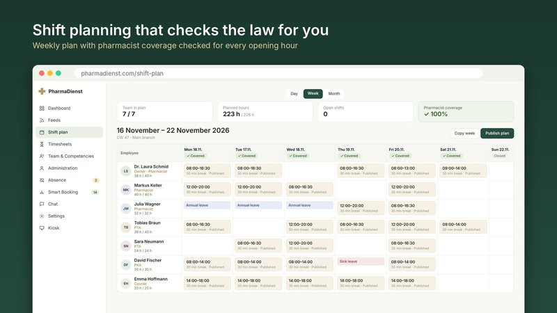
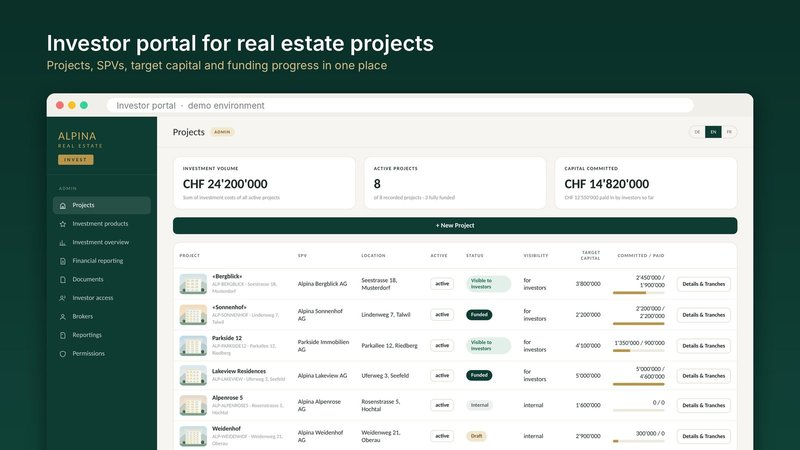
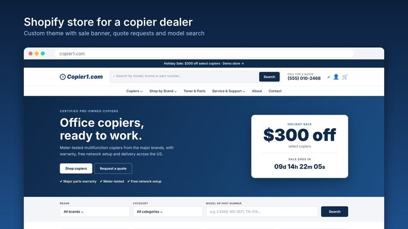

<a href="https://javedahmed-ai.github.io"></a>

<p align="center">
  <a href="https://javedahmed-ai.github.io"></a>
  <a href="https://www.linkedin.com/in/javedahmmed/"></a>
  <a href="https://www.fiverr.com/javedahmed1998"></a>
  
</p>

## Hi, I'm Javed 👋

I build **AI tools and custom software for small businesses**: systems that answer the phone, book the appointment, plan the shifts and replace the spreadsheet.

I come from **IT and DevOps**, so I don't stop at a demo. I handle hosting, security and backups, and I keep the system running after launch.

```yaml
focus:     AI receptionists · chatbots · booking & scheduling · CRM · Shopify
clients:   pharmacies (Germany) · real estate · e-commerce · clinics & service businesses
based_in:  Indonesia · working remotely with clients in the US & Europe
```

---

## 🚀 Featured work

<table>
  <tr>
    <td width="50%" valign="top">
      <a href="https://javedahmed-ai.github.io/#work"></a>
      <h3>📞 Join Intake: AI receptionist</h3>
      Picks up every call 24/7, answers questions, summarises the call and books the appointment.<br><br>
      <code>Voice AI</code> <code>LLM</code> <code>Booking</code> <code>Dashboard</code>
    </td>
    <td width="50%" valign="top">
      <a href="https://javedahmed-ai.github.io/#work"></a>
      <h3>💊 PharmaDienst: pharmacy scheduling</h3>
      Shift planning, absences and timesheets for pharmacy teams in Germany, across multiple branches.<br><br>
      <code>Next.js</code> <code>TypeScript</code> <code>PostgreSQL</code> <code>Prisma</code>
    </td>
  </tr>
  <tr>
    <td width="50%" valign="top">
      <a href="https://javedahmed-ai.github.io/#work"></a>
      <h3>📅 Smart Booking: online appointments</h3>
      Public booking page for pharmacy services such as vaccinations and health checks, with no double-booking.<br><br>
      <code>Availability engine</code> <code>Reminders</code> <code>GDPR</code>
    </td>
    <td width="50%" valign="top">
      <a href="https://javedahmed-ai.github.io/#work"></a>
      <h3>🏢 Investor portal: real estate</h3>
      Projects, documents and progress updates for investors, with role-based access per project.<br><br>
      <code>Auth & roles</code> <code>Documents</code> <code>Dashboards</code>
    </td>
  </tr>
  <tr>
    <td width="50%" valign="top">
      <a href="https://javedahmed-ai.github.io/#work"></a>
      <h3>🚲 CyberBike: e-commerce admin + AI chat</h3>
      Custom store backend for a US e-bike brand, with an AI assistant answering product, financing and order questions 24/7.<br><br>
      <code>AI chatbot</code> <code>Orders</code> <code>Products</code> <code>SMS campaigns</code>
    </td>
    <td width="50%" valign="top">
      <a href="https://javedahmed-ai.github.io/#work"></a>
      <h3>🖨️ Copier1: Shopify store</h3>
      Shopify store for a US copier dealer, with a custom theme, model search, filters and quote requests.<br><br>
      <code>Shopify</code> <code>Liquid</code> <code>Custom theme</code>
    </td>
  </tr>
  <tr>
    <td width="50%" valign="top">
      <a href="https://javedahmed-ai.github.io/#work"></a>
      <h3>🏗️ Cutting Edge Decking: website + CMS</h3>
      Website and custom admin for a steel deck manufacturer, with live chat, interactive 3D projects and built-in analytics.<br><br>
      <code>CMS</code> <code>3D models</code> <code>Live chat</code> <code>Analytics</code>
    </td>
    <td width="50%" valign="top">
      <a href="https://javedahmed-ai.github.io/#work"></a>
      <h3>📐 AI takeoff tool for estimators</h3>
      Upload a PDF drawing, let AI detect the scale and specs, measure deck areas and export a full bill of materials.<br><br>
      <code>PDF parsing</code> <code>AI</code> <code>Canvas drawing</code> <code>Estimating</code>
    </td>
  </tr>
</table>

<sub>Client code is private. Screenshots show demo environments with sample data. More on the <a href="https://javedahmed-ai.github.io">portfolio</a>.</sub>

---

## 🛠️ What I can build for you

| Service | What you get |
|---|---|
| 🤖 **AI receptionists & voice agents** | Answer calls 24/7, qualify callers, book appointments, transfer urgent calls |
| 💬 **Chatbots & AI assistants** | Website and WhatsApp bots trained on your services, prices and FAQs |
| 📆 **Booking & scheduling systems** | Online booking, staff shifts, absences, reminders, multi-location |
| 📇 **CRM & internal dashboards** | Replace Excel and WhatsApp with one system for leads, clients and tasks |
| 🛒 **Shopify** | Stores, custom themes, apps and integrations |
| ☁️ **Hosting & DevOps** | Docker, AWS, CI/CD, monitoring and backups, so it keeps running |

## 🧰 Tech stack

<p>
  
  
  
  
  
  
  
  
  
  
  
  
  
</p>

## 🤝 Work with me

Got calls you miss, bookings done by hand, or a business running on spreadsheets? Send me a short note about your business. I'll reply with how I'd approach it and a rough price.

<p>
  <a href="https://www.linkedin.com/in/javedahmmed/"><b>Message me on LinkedIn →</b></a>
</p>
