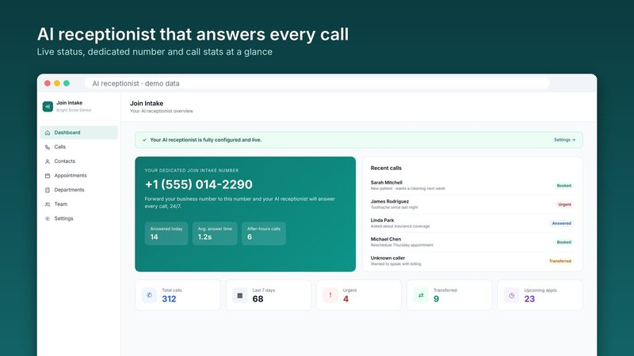
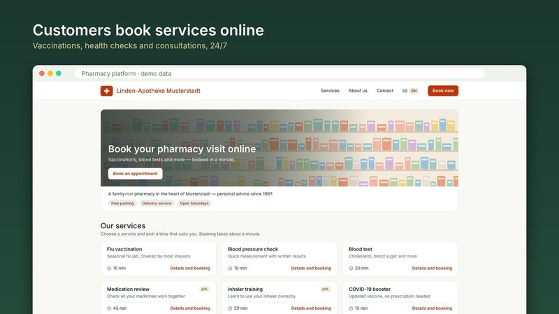
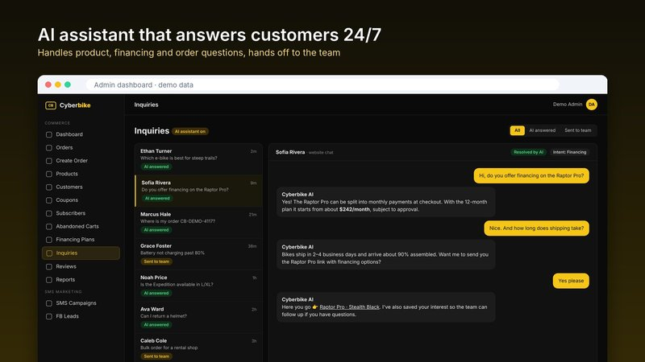
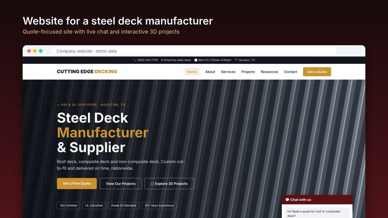
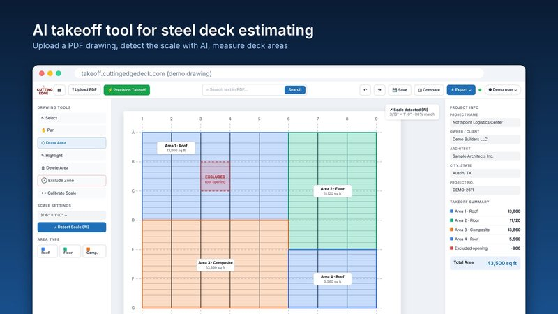

## Javed Ahmed

I build AI tools and custom software for small businesses — systems that answer the phone, book the appointment, plan the shifts and replace the spreadsheet. I started in IT and DevOps, so I also handle hosting, security and backups, and stay on after launch to keep things running.

[Portfolio](https://javedahmed-ai.github.io) · [LinkedIn](https://www.linkedin.com/in/javedahmmed/) · [Fiverr](https://www.fiverr.com/javedahmed1998) (4.9★, 37 reviews) · Open for new projects

---

### Featured work

<table>
  <tr>
    <td width="50%" valign="top">
      
       <b>Join Intake — AI receptionist</b> 
      Picks up every call 24/7, answers questions, summarises the call and books the appointment.  
      <code>Voice AI</code> <code>LLM</code> <code>Booking</code>
    </td>
    <td width="50%" valign="top">
      
       <b>PharmaDienst — pharmacy scheduling</b> 
      Shift planning, absences and timesheets for pharmacy teams in Germany, across multiple branches.  
      <code>Next.js</code> <code>PostgreSQL</code> <code>Prisma</code>
    </td>
  </tr>
  <tr>
    <td width="50%" valign="top">
      
       <b>Smart Booking — online appointments</b> 
      Public booking page for pharmacy services such as vaccinations and health checks, with no double-booking.  
      <code>Availability engine</code> <code>Reminders</code>
    </td>
    <td width="50%" valign="top">
      
       <b>Investor portal — real estate</b> 
      Projects, documents and progress updates for investors, with role-based access per project.  
      <code>Auth &amp; roles</code> <code>Dashboards</code>
    </td>
  </tr>
  <tr>
    <td width="50%" valign="top">
      
       <b>CyberBike — e-commerce admin + AI chat</b> 
      Custom store backend for a US e-bike brand, with an AI assistant answering product and order questions 24/7.  
      <code>AI chatbot</code> <code>Orders</code> <code>Products</code>
    </td>
    <td width="50%" valign="top">
      
       <b>Copier1 — Shopify store</b> 
      Shopify store for a US copier dealer, with a custom theme, model search, filters and quote requests.  
      <code>Shopify</code> <code>Liquid</code>
    </td>
  </tr>
  <tr>
    <td width="50%" valign="top">
      
       <b>Cutting Edge Decking — website + CMS</b> 
      Website and custom admin for a steel deck manufacturer, with live chat, 3D projects and built-in analytics.  
      <code>CMS</code> <code>3D models</code> <code>Analytics</code>
    </td>
    <td width="50%" valign="top">
      
       <b>AI takeoff tool for estimators</b> 
      Upload a PDF drawing, let AI detect the scale and specs, measure deck areas and export a bill of materials.  
      <code>PDF parsing</code> <code>AI</code>
    </td>
  </tr>
</table>

Client code is private. Screenshots show demo environments with sample data. More on the <a href="https://javedahmed-ai.github.io">portfolio</a>.

---

### What I can build

| Service | What you get |
|---|---|
| AI receptionists & voice agents | Answer calls 24/7, qualify callers, book appointments, transfer urgent calls |
| Chatbots & AI assistants | Website and WhatsApp bots trained on your services, prices and FAQs |
| Booking & scheduling systems | Online booking, staff shifts, absences, reminders, multi-location |
| CRM & internal dashboards | Replace spreadsheets and WhatsApp with one system for leads, clients and tasks |
| Shopify | Stores, custom themes, apps and integrations |
| Hosting & DevOps | Docker, AWS, CI/CD, monitoring and backups, so it keeps running |

### Stack

TypeScript · Next.js · React · Node.js · Python · PostgreSQL · Prisma · OpenAI · Shopify · Docker · AWS · Linux

---

Got calls you miss, bookings done by hand, or a business running on spreadsheets? [Message me on LinkedIn](https://www.linkedin.com/in/javedahmmed/) with a short note about your business — I'll reply with how I'd approach it and a rough price.
